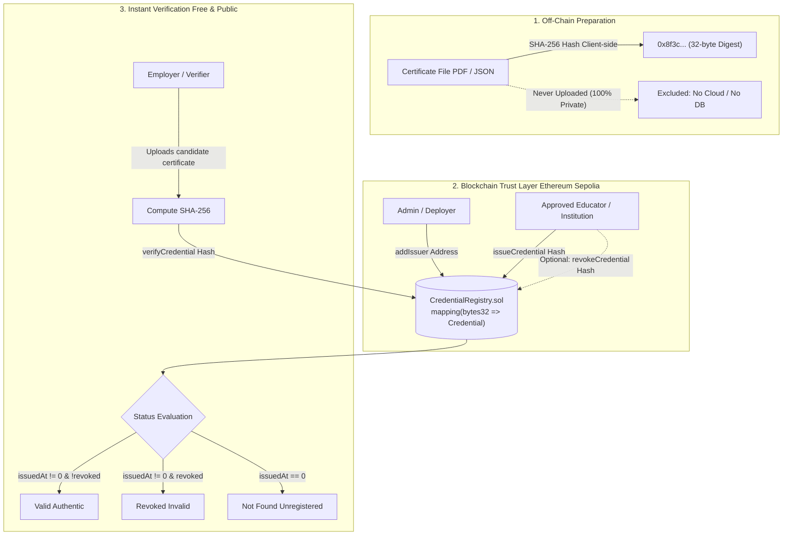

# 🎓 On-Chain Credential Verification for ArivuHub

[](https://soliditylang.org/)
[](https://hardhat.org/)
[](https://sepolia.etherscan.io/)
[]()
[](https://opensource.org/licenses/MIT)

> **Decentralized trust layer for educational credentials.**  
> Approved educational institutions and verified instructors register cryptographic fingerprints (SHA-256) of credentials directly on Ethereum Sepolia. Anyone—employers, students, and platforms—can instantly verify authenticity in 0 gas without relying on a central database, proprietary API, or single point of failure.

---

## 📌 Table of Contents

- [The Problem & ArivuHub Vision](#-the-problem--arivuhub-vision)
- [How It Works (Architecture & Data Flow)](#-how-it-works-architecture--data-flow)
- [System Roles & Permissions](#-system-roles--permissions)
- [Cryptographic Privacy & Off-Chain Hashing](#-cryptographic-privacy--off-chain-hashing)
- [Smart Contract Specification](#-smart-contract-specification)
- [Project Structure](#-project-structure)
- [Comprehensive Test Suite (22 Tests)](#-comprehensive-test-suite-22-tests)
- [Step-by-Step Setup & Quickstart](#-step-by-step-setup--quickstart)
- [Deploying to Sepolia Testnet](#-deploying-to-sepolia-testnet)
- [Remix IDE Testing Walkthrough](#-remix-ide-testing-walkthrough)
- [Frontend Web App](#-frontend-web-app)
- [Security, Trade-offs & Design Decisions](#-security-trade-offs--design-decisions)
- [Interview & Application Cheat Sheet](#-interview--application-cheat-sheet)
- [Screenshots & Verification Links](#-screenshots--verification-links)

---

## 🎯 The Problem & ArivuHub Vision

In traditional education and online learning platforms:
1. **Credentials are trivial to forge:** PDFs, image certificates, and diplomas can be edited in seconds using photo editing software.
2. **Verification is slow and centralized:** Employers must manually email universities or query closed databases that may go offline, shut down, or suffer data breaches.
3. **Privacy risks (PII leaks):** Storing full student certificates on a blockchain or public cloud creates severe privacy and GDPR violations.

### The ArivuHub Solution
**ArivuHub** empowers verified educators to grant tamper-evident credentials. By storing **only the cryptographic SHA-256 digest** of the certificate file on-chain:
- **Zero Personal Data On-Chain:** Student names, grades, and identifiers never touch the public ledger.
- **100% Tamper Detection:** Modifying even a single character or byte in the certificate changes the SHA-256 hash completely (avalanche effect).
- **Zero-Gas Verification:** Verification uses a Solidity `view` function (`verifyCredential`), making checks 100% free and instant for employers and verifiers worldwide.

---

## 🔄 How It Works (Architecture & Data Flow)



---

## 👥 System Roles & Permissions

| Role | Entity | Capabilities | Gas Cost |
|---|---|---|---|
| **Admin** | Deployer / Governance | Approves (`addIssuer`) or de-authorizes (`removeIssuer`) institutions. | Paid (State change) |
| **Issuer** | Verified Institution / Educator | Registers certificate hashes (`issueCredential`), revokes previously issued credentials (`revokeCredential`). | Paid (State change) |
| **Verifier** | Public / Employer / Student | Inspects credentials (`verifyCredential`), queries issuer validity (`isIssuer`). | **Free (0 Gas `view`)** |

---

## 🔐 Cryptographic Privacy & Off-Chain Hashing

The system adheres strictly to the principle of **minimal on-chain footprint**:

$$\text{File (PDF/JSON)} \xrightarrow{\text{SHA-256}} \text{bytes32 digest (256 bits)}$$

- **Avalanche Effect:** A 1-bit alteration in the input file produces an entirely uncorrelated 256-bit digest.
- **Collision Resistance:** Finding two distinct files that yield the same SHA-256 hash requires $\approx 2^{128}$ operations, making deliberate counterfeiting computationally infeasible.
- **Client-Side Hashing:** In the frontend and CLI, the file is read as an `ArrayBuffer` directly in memory and hashed with `ethers.sha256()`. The underlying file **never leaves the user's computer**.

---

## 📜 Smart Contract Specification

**Contract:** [`contracts/CredentialRegistry.sol`](contracts/CredentialRegistry.sol)  
**Compiler:** `Solidity ^0.8.20`  
**License:** `MIT`

```solidity
struct Credential {
    address issuer;   // Account that registered the hash
    uint256 issuedAt; // Block timestamp of issuance (0 = unissued)
    bool revoked;     // Revocation flag
}
```

### Core Functions & Signatures
- `addIssuer(address issuer) external onlyAdmin`
- `removeIssuer(address issuer) external onlyAdmin`
- `issueCredential(bytes32 hash) external onlyIssuer`
- `revokeCredential(bytes32 hash) external` *(Enforces: caller must match original issuer)*
- `verifyCredential(bytes32 hash) external view returns (bool valid, address issuer, uint256 issuedAt, bool revoked)`

---

## 📂 Project Structure

```
onchain-credential-verification/
├── contracts/
│   └── CredentialRegistry.sol       # Core smart contract with NatSpec documentation
├── test/
│   └── CredentialRegistry.ts        # Comprehensive Chai/Hardhat test suite (22 tests)
├── scripts/
│   └── deploy.ts                    # Dynamic network deployment script
├── frontend/                        # Clean, responsive Web3 interface
│   ├── src/
│   │   ├── components/
│   │   │   ├── FilePicker.tsx       # Drag-and-drop file selector
│   │   │   ├── IssueTab.tsx         # Issuer portal with MetaMask connection
│   │   │   └── VerifyTab.tsx        # Instant client-side verification view
│   │   ├── lib/
│   │   │   └── contract.ts          # ethers.js v6 abstraction & error handlers
│   │   ├── config.ts                # Contract address, ABI, & RPC endpoints
│   │   ├── App.tsx                  # Tab navigation & layout
│   │   └── styles.css               # Clean modern UI styling
│   ├── index.html
│   ├── package.json
│   └── vite.config.ts
├── hardhat.config.ts                # Hardhat 2 configuration & Sepolia network setup
├── package.json                     # Scripts & devDependencies
├── tsconfig.json
├── .env.example                     # Sanitized environment template
└── README.md
```

---

## 🧪 Comprehensive Test Suite (22 Tests)

The test suite in [`test/CredentialRegistry.ts`](test/CredentialRegistry.ts) verifies full functional coverage, role access boundaries, and failure reverts:

```text
  CredentialRegistry
    Deployment
      ✔ sets the deployer as admin
      ✔ starts with no issuers
    Issuer management
      ✔ admin can add an issuer and emits IssuerAdded
      ✔ admin can remove an issuer and emits IssuerRemoved
      ✔ non-admin cannot add an issuer
      ✔ non-admin cannot remove an issuer
      ✔ rejects the zero address and duplicate issuers
      ✔ cannot remove an address that is not an issuer
    Issuing
      ✔ approved issuer can issue and emits CredentialIssued
      ✔ duplicate issue reverts
      ✔ non-issuer cannot issue
      ✔ rejects an empty hash
      ✔ removed issuer can no longer issue
      ✔ credentials issued before removal stay valid
    Verifying
      ✔ returns valid=true with issuer and timestamp for an issued hash
      ✔ returns valid=false and zero address for an unknown hash
    Revoking
      ✔ only the original issuer can revoke
      ✔ another approved issuer cannot revoke someone else's credential
      ✔ issuer revokes, event is emitted, and verify returns valid=false, revoked=true
      ✔ cannot revoke twice
      ✔ cannot revoke an unknown hash
      ✔ a revoked hash cannot be re-issued

  22 passing (4s)
```

Run tests locally with:
```powershell
npm test
```

---

## 🚀 Step-by-Step Setup & Quickstart

### Prerequisites
- [Node.js](https://nodejs.org/) v20+ LTS
- [MetaMask](https://metamask.io/) browser extension

### 1. Clone & Install Dependencies
```powershell
npm install
```

### 2. Compile Contract
```powershell
npm run compile
```

### 3. Run Automated Tests
```powershell
npm test
```

### 4. Local Blockchain Simulation (Optional)
Run a private local EVM node with 20 funded test accounts:
```powershell
# In Terminal 1:
npx hardhat node

# In Terminal 2:
npm run deploy:local
```

---

## 🌐 Deploying to Sepolia Testnet

### 1. Configure Environment Secrets
Create a local `.env` file (strictly git-ignored):
```powershell
Copy-Item .env.example .env
```
Fill in your credentials:
```ini
SEPOLIA_RPC_URL="https://eth-sepolia.g.alchemy.com/v2/YOUR_API_KEY"
PRIVATE_KEY="YOUR_TEST_WALLET_PRIVATE_KEY"
```

> ⚠️ **Critical Security Rule:** Use a dedicated test account with 0 mainnet balance. Never commit or expose your private key.

### 2. Obtain Sepolia Test ETH
- [Google Cloud Web3 Sepolia Faucet](https://cloud.google.com/application/web3/faucet/ethereum/sepolia)
- [Alchemy Sepolia Faucet](https://www.alchemy.com/faucets/ethereum-sepolia)
- [Infura Sepolia Faucet](https://www.infura.io/faucet/sepolia)

### 3. Deploy
```powershell
npm run deploy:sepolia
```
Output will display:
```text
Network:  sepolia
Deployer: 0xYourAdminAddress (will be admin)
CredentialRegistry deployed to: 0xYourContractAddress
Deployment tx: 0xYourTxHash
Etherscan: https://sepolia.etherscan.io/address/0xYourContractAddress
```

### 4. Link Address to Frontend & Docs
Paste the deployed contract address into:
1. `frontend/src/config.ts` (`CONTRACT_ADDRESS`)
2. The [Deployed Contract](#-deployed-contract) section below.

---

## 🛠️ Remix IDE Testing Walkthrough

If you prefer testing directly in the browser via [Remix IDE](https://remix.ethereum.org/):

1. **Paste Contract:** Create `CredentialRegistry.sol` in Remix and paste the contract code.
2. **Compile:** Under **Solidity Compiler**, select `0.8.20` and click **Compile**.
3. **Deploy:** Under **Deploy & Run Transactions**, choose **Remix VM (Cancun)**. Click **Deploy**.
4. **Execute Verification Checklist:**

| # | Action | Account | Expected Result |
|---|---|---|---|
| 1 | `addIssuer(Account 2)` | Account 1 (Admin) | ✅ Success; `isIssuer(Account 2)` returns `true` |
| 2 | `issueCredential(hash)` | Account 2 (Issuer) | ✅ Success; `CredentialIssued` event logged |
| 3 | `verifyCredential(hash)` | Account 3 (Verifier) | ✅ `valid = true, issuer = Account 2, issuedAt = timestamp` |
| 4 | `verifyCredential(otherHash)` | Any Account | ✅ `valid = false, issuer = 0x0...` |
| 5 | `issueCredential(hash)` | Account 2 | ❌ Reverts: `"Already issued"` |
| 6 | `issueCredential(newHash)` | Account 3 (Outsider) | ❌ Reverts: `"Not an approved issuer"` |
| 7 | `addIssuer(Account 3)` | Account 2 (Non-Admin) | ❌ Reverts: `"Not admin"` |
| 8 | `revokeCredential(hash)` | Account 3 | ❌ Reverts: `"Only original issuer"` |
| 9 | `revokeCredential(hash)` | Account 2 | ✅ Success; `verifyCredential` returns `valid = false, revoked = true` |
| 10 | `removeIssuer(Account 2)` | Account 1 (Admin) | ✅ Success; Account 2 can no longer issue new credentials |

---

## 💻 Frontend Web App

A clean, responsive React interface powered by **Vite** and **ethers.js v6**:

- **Verify Tab (Public):** Drag & drop any certificate. Computes SHA-256 locally and calls `verifyCredential()` over a public read-only RPC provider. Requires **no wallet connection, no signatures, and zero gas**.
- **Issue Tab (Issuer Portal):** Connects with MetaMask, validates that the network is Sepolia, verifies issuer eligibility, and submits `issueCredential(hash)` to the blockchain with live Etherscan receipt links.

### Running the Frontend
```powershell
cd frontend
npm install
npm run dev
```
Visit `http://localhost:5173`.

---

## 🛡️ Security, Trade-offs & Design Decisions

### 1. Why a Revocation Flag Instead of Storage Deletion?
In standard databases, revoking a record often deletes it. On Ethereum:
- A deleted entry resets storage to zero, making an inquiry indistinguishable from a certificate that **never existed**.
- A boolean `revoked = true` flag preserves the immutable historical record: verifiers can clearly see *who* issued it, *when* it was issued, and *that it was deliberately revoked*.
- Once issued and revoked, the same hash cannot be re-issued maliciously.

### 2. Zero-Gas Verification
The `verifyCredential` method is marked as `external view`. When called off-chain via an RPC provider (like Infura or Alchemy), the node executes the bytecode locally without generating a transaction or consuming gas.

### 3. Trust Model & Decentralization Boundaries
- **Current Model:** The contract admin controls the approved issuer whitelist.
- **Future Decentralization (Roadmap):** Replace single-key admin with a **multi-signature wallet (Gnosis Safe)** or community DAO governance to eliminate the administrative single point of failure.

---

## 🎓 Interview & Application Cheat Sheet

### One-Line Project Summary
> *Built and deployed an on-chain credential verification registry in Solidity on Ethereum Sepolia: approved issuers register certificate hashes and anyone can verify authenticity without trusting a central database.*

### Comprehensive Summary (~80 words)
> *I built CredentialRegistry, a Solidity smart contract where admin-approved issuers register the SHA-256 hash of a certificate and anyone can verify a file against it. Only hashes are stored on-chain, so personal data stays private, and issuers can revoke their own credentials. I tested access control and failure cases across 22 automated tests, deployed to the Sepolia testnet, and built an ethers.js interface for issuing and verifying. It connects directly to my ArivuHub platform, where verified educators need trustworthy, tamper-proof credentials.*

### Top 5 Technical Questions & Answers
<details>
<summary><strong>1. Why store only the hash instead of the certificate file or IPFS URI?</strong></summary>

Storing the full file on-chain is prohibitively expensive in gas and exposes sensitive Personally Identifiable Information (PII) to a permanent public ledger. Storing the SHA-256 hash ensures complete student privacy (GDPR compliance), minimal gas usage (single 32-byte storage slot), and cryptographically guarantees that any modification to the certificate renders the hash invalid.
</details>

<details>
<summary><strong>2. What is the risk of a SHA-256 collision in this architecture?</strong></summary>

SHA-256 has a keyspace of $2^{256}$ (~$1.15 \times 10^{77}$ combinations). Finding a hash collision would require astronomical computational power exceeding global computing capacity. Thus, certificate forgery via deliberate collision is practically impossible.
</details>

<details>
<summary><strong>3. Why does verification cost zero gas?</strong></summary>

`verifyCredential` is marked as a `view` function. View functions do not alter blockchain state. When queried from an off-chain client (e.g. browser, mobile app, or backend script), the query is evaluated entirely on the local Ethereum node and requires no consensus or gas fees.
</details>

<details>
<summary><strong>4. Why can't a revoked credential be re-issued?</strong></summary>

`issueCredential` requires `credentials[hash].issuedAt == 0`. When a credential is issued, `issuedAt` is stamped with the block timestamp. Revocation toggles `revoked = true` without resetting `issuedAt`. This prevents an attacker or malicious issuer from re-cycling or re-issuing a discredited credential.
</details>

<details>
<summary><strong>5. Where does centralization still exist in this version, and how would you fix it?</strong></summary>

The `admin` address is currently an EOA (Externally Owned Account) that controls `addIssuer` and `removeIssuer`. If that private key is compromised, the issuer list could be manipulated. In production, this would be transitioned to a Multi-Sig (Gnosis Safe) requiring $m$-of-$n$ trusted signatories or a decentralized DAO governance voting mechanism.
</details>

---

## 📋 Deployed Contract & Verification Links

*Record your deployment values here after running `npm run deploy:sepolia`:*

- **Network:** Ethereum Sepolia Testnet
- **Contract Address:** `0x...`
- **Deployment Transaction:** `https://sepolia.etherscan.io/tx/0x...`
- **Sample Issue Transaction:** `https://sepolia.etherscan.io/tx/0x...`
- **Sample Verified Hash:** `0x...`

---

## 📷 Screenshots

| Automated Test Suite (22 Passing) | Sepolia Etherscan Verification |
|---|---|
| *(Screenshot of `npm test` passing)* | *(Screenshot of contract on Etherscan)* |

| Verify Portal (Authentic Credential) | Issuer Portal (MetaMask Interaction) |
|---|---|
| *(Screenshot showing Valid status)* | *(Screenshot showing issue transaction)* |

---

## 📄 License
This project is open-source under the [MIT License](LICENSE).
